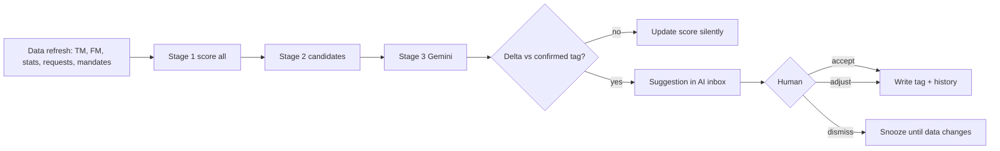

# Level & Focus — Player Tiering with AI (Men platform)

Status: **v2 — decisions locked, ready to refine screens**

Mocks (open in a browser; EN/HE toggle in both):
- [`brit-sport-group-dashboard-roster-intelligence.html`](./brit-sport-group-dashboard-roster-intelligence.html) — **the real dashboard, with the new Roster intelligence module** (see §12)
- [`brit-sport-group-level-focus.html`](./brit-sport-group-level-focus.html) — the full feature: board, AI inbox, engine, calibration, alerts (press `/` for Ask AI)

## 0. Decisions (v2)

| Topic | Decision |
|---|---|
| Scope v1 | **Roster only.** Shortlist and ScoutProfiles come later |
| Levels | 5 levels, with **market-specific meaning** (Ligat Ha’al / Europe / Gulf) and a **bar per position group** |
| Who can change tags | **Any agent.** Notes are **optional**, never required (history still records who and when) |
| Focus drivers | Contract, mandate, matching requests, last touch, trend. **No revenue/commission** |
| Effort tracking | **Automatic** from notes, tasks and contacts. No manual quick-log |
| Alerts | **Yes** — when a player becomes Push now (plus a few optional rules) |
| Platforms | **Men only** |


---

## 1. The problem

- The database is huge (roster + shortlist + ~48K `ScoutProfiles` + Transfer Radar). Nothing tells us **how good** a player is *in our own terms*, nor **how hard** we should work on him.
- Dashboard "Roster intelligence" today = top 6 by market value (`MenDashboard.tsx` ~L793, ~L1427). Static, not clickable, no decision value.
- Existing tiers don't solve it and use overlapping words: `sign/monitor/watch` (`scout-profiles/route.ts`), `A/B/C` + `SIGN/MONITOR/PASS` (Alpha Board). Those are **per-search verdicts**, not a persistent agency judgement.

## 2. Core idea: two separate questions

Mixing "how good" and "how urgent" into one tier is the classic trap (a great player with 3 years of contract needs less effort than an average one whose mandate expires Friday). So we store them separately.

| Axis | Question | Values | Who sets it |
|---|---|---|---|
| **Level** | What can he play at? (current ability, market-adjusted) | L1 Elite · L2 Premium · L3 Core · L4 Depth · L5 Developing | AI proposes → human confirms |
| **Focus** | How much effort now? | F1 Push now · F2 Active · F3 Maintain · F4 Park | AI proposes → human confirms |
| **Trend** (signal) | Rising / flat / falling | ▲ ● ▼ | AI only |

Level × Focus gives a 5×4 matrix = the **effort allocation map** (the main board).

> Naming: "Level 1-5" and "Focus" deliberately avoid A/B/C and sign/monitor/watch so the three concepts never get confused. Alpha Board verdicts remain *search-time* opinions; Level & Focus is the *persistent* one.

### Level definitions (to be confirmed with the team — see open questions)
| Level | Meaning for our market |
|---|---|
| L1 Elite | Moves us into top-5 / Champions-League-level deals |
| L2 Premium | Starter at strong European clubs / top of Ligat Ha’al |
| L3 Core | Reliable top-flight starter |
| L4 Depth | Rotation / lower division |
| L5 Developing | Unproven, long-shot, or declining |

Potential is **not** baked into Level. It shows up as **Trend** and in AI's ±1 upside adjustment (always explained).

## 3. How the AI is involved (the "wow")

Principle: **maths is cheap and runs on everyone; AI is expensive and runs where it matters; humans decide.**

```
Stage 1  Deterministic score (all players, no AI cost)
         weighted: output percentile (position+league adjusted), FM CA/PA, market value percentile,
         league coefficient, form  → score 0-100 → thresholds → base Level
Stage 2  Candidate filter
         roster, shortlist, mandate targets, open-request matches, borderline scores (±3 of a line),
         big movers (value, form, contract) → ~1-2% of universe
Stage 3  Gemini analysis (gemini-2.5-flash, JSON out, existing pattern)
         input: stats + FM + notes + highlights + contract/mandate + demand
         output: adj (-1|0|+1), trend, reasonEn/reasonHe, evidence[], confidence
Stage 4  Delta engine
         only changes to Level/Focus go to the human inbox; everything else updates silently
```

Guard-rails (non-negotiable): AI moves a level **max ±1**; AI **never writes** a confirmed tag — it writes a *suggestion*; every change is recorded in history (who, when, optional note); per-player **lock**; confidence shown; dismissed suggestions aren't repeated until data changes.

### Wow moments in the mock
1. **Before/After** dashboard module (toggle on Overview).
2. **AI inbox** — "accept all ≥ 85% confidence", one-click accept/adjust/dismiss.
3. **Player drawer** — ladder with AI marker, streamed "re-run analysis", evidence chips, signal breakdown, history, same-level peers.
4. **Ask AI** (`/` anywhere) — natural language over the roster: "Who should I push this week?", "Core players expiring in 6 months", "Anyone drifting down?"
5. **Calibration with live impact** — move a weight or threshold and instantly see which players change level before saving.
6. **Effort vs. priority** — compares where your time went to where it should have gone.

## 4. Flows

### 4.1 Nightly loop


### 4.2 Agent daily flow
Dashboard → sees "AI needs your call (n)" + "Focus now" → opens drawer → accepts/overrides → works the player (notes, tasks and contacts are counted automatically) → effort bars update.

### 4.3 Manual tagging flow
Player profile, drawer or board → any agent sets Level/Focus (note optional) → history entry → optionally lock.

### 4.4 Universe flow (large DB)
Stage 1 weekly on `ScoutProfiles` after the scout build; Stage 3 only for top ~2% + borderline. AI Scout / War Room gain a **Level filter and badge**. A player promoted from Radar/Scout to roster **inherits** their computed Level.

## 5. Screens (all in the mock)

| # | Screen | Purpose |
|---|---|---|
| 1 | **Overview → Roster intelligence (After)** | Replaces the top-6 table: level distribution bar (clickable), Focus-now list with AI "why", AI-needs-your-call, attention gaps, effort-vs-priority, Ask AI box |
| 2 | **Level & Focus board** | Matrix (Level×Focus, pills with gold dot = pending AI suggestion) + list; filters; bulk set |
| 3 | **Player drawer** | Ladder, focus, AI read, evidence, signals, automatic effort, optional note, lock, peers, history |
| 4 | **AI inbox** | Review queue sorted by impact; batch accept |
| 5 | **Engine** | Pipeline visibility, populations & cadence, cost, guard-rails |
| 6 | **Calibration** | Weights, thresholds, position presets, live impact preview |
| 7 | **Ask AI overlay** | Natural-language roster queries |

Dashboard replacement is the primary deliverable; the rest are what makes it trustworthy.

## 6. Data model (proposal)

New collection, keyed by Transfermarkt id so it covers **non-roster** players too:

`PlayerTiers/{tmId}`
```
level: 1-5            // confirmed (human)
focus: 1-4            // confirmed (human)
locked: bool
confirmedBy, confirmedAt
ai: { baseLevel, adj, suggestedLevel, suggestedFocus, trend, score, urgency,
      confidence, reasonEn, reasonHe, evidence[], model, computedAt, dataHash }
dismissedUntilHash?: string
history/{auto}: { at, by, kind: manual|ai-accepted|bulk|system, from, to, reason }
```
Roster `Players` gets denormalised `tierLevel`, `tierFocus` (read by dashboard without a join; add to `ALLOWED_UPDATE_FIELDS` in `functions/callables/players.js` or write only through a dedicated callable). Config doc `Config/tiering` holds weights/thresholds/presets by position.

Rules: read for authenticated users; writes only via callable (audit trail) + backend job for `ai.*`.

## 7. Scoring (v1)

- `score = Σ wᵢ·signalᵢ / Σ wᵢ`, signals 0-100: output (percentile within position, league-coefficient adjusted), FM CA/PA index, market-value percentile, league strength, form. Defaults 30/25/20/10/15.
- Thresholds (L1…L4): 78 / 64 / 50 / 36.
- `urgency = .38·time + .27·demand + .17·gap + .18·momentum` (time = contract months & mandate days; demand = matching open requests; gap = days since last touch).
- `focus = f(.7·urgency + .3·levelWeight)`; thresholds 62 / 50 / 39.
- Position presets (forwards weight output, GK weight form, youth weight potential).
- Reuse: `parseMarketValue`, `computeVerdict` ingredients in `scout-profiles/route.ts`, FM data via `playerIntel.ts`, stats via `fetchPlayerStats`.

## 8. Technical plan (where it lands)

| Layer | Work |
|---|---|
| Lib | `lib/tiering/{score,urgency,thresholds,types}.ts` (pure, unit-testable) |
| API | `POST /api/tiering/analyze` (Gemini, single player), `GET /api/tiering/list` (paginated, server-side — no whole-collection listeners), `POST /api/tiering/ask` |
| Jobs | Nightly/weekly GitHub Actions or Cloud Run worker, same pattern as `radar-pipeline.yml` / scout build |
| Callables | `tiersSet`, `tiersAcceptSuggestion`, `tiersBulkSet` (with history) |
| UI | `components/tiering/{LevelChip,FocusChip,TierMatrix,TierDrawer,TierInbox,RosterIntelligence}.tsx`; replace the module in `MenDashboard.tsx`; new routes `/tiering` (+ `/tiering/inbox`, `/tiering/calibration`) |
| i18n | EN + HE keys in `LanguageContext.tsx`; RTL verified (mock already has it) |
| Flags | `featureFlags.ts` → `TIERING_ENABLED` for staged rollout |
| Integrations | Level badge in `/players`, shortlist, AI Scout, War Room; task creation from "attention gaps" |

## 9. Rollout

1. **MVP (roster only):** Stage 1 + manual tagging + dashboard module + board + drawer. No Gemini yet.
2. **AI layer:** Gemini analysis, inbox, history, Ask AI.
3. **Calibration + effort tracking** (needs contact/task logging hooks).
4. **Universe:** shortlist + ScoutProfiles scoring, badges in AI Scout / War Room.
5. **Learning loop:** feed accept/dismiss decisions back as few-shot examples and auto-suggest weight changes.

## 10. Risks

- **Trust:** wrong early suggestions kill adoption → start roster-only, show confidence, keep humans in control.
- **Cost / rate limits:** Gemini free-tier limits already shaped `war-room/report`; the candidate filter keeps volume ~1-2%.
- **Data gaps:** many players lack FM/stats → compute confidence from coverage and say "low data" instead of guessing.
- **Scale:** don't use `onSnapshot` on the universe; paginate server-side.
- **Concept collision** with Alpha Board tiers → naming + UI separation (see §2).

## 11. Position bars and market definitions

Draft definitions (editable in the Calibration screen):

| Level | Ligat Ha’al | Europe | Gulf |
|---|---|---|---|
| L1 Elite | Key player of a title-winning club; European group-stage level | Starter at a top-5-league or Champions-League club | Marquee starter at a Saudi Pro League top-4 club |
| L2 Premium | Starter at a top-3 club | Starter in strong second-tier leagues (NL, PT, BE, TR) or top-5 rotation | Regular starter in Saudi / UAE Pro League |
| L3 Core | Reliable starter at a mid-table club | Starter in mid-tier leagues (GR, AT, CY, CH) or top-5 second division | Starter at a mid-table Gulf club (QAT, KUW, BHR) |
| L4 Depth | Rotation / lower-half club | Lower leagues, bench at mid-tier clubs | Rotation at lower-tier Gulf clubs |
| L5 Developing | Unproven youth, long-shot or clearly declining | judged by trend | judged by trend |

**Position bars.** Six groups (GK, CB, FB, DM/CM, AM/wingers, ST). Each has an offset added to the four base thresholds, so "Premium" means the same thing for a goalkeeper and a striker even though raw output stats differ. The AI can *suggest* offsets (example in the mock: GK −3, CB −2, AM +2, ST +3) and Calibration shows live which players would change before you save.

**Needs your input:** the table above is my draft from general football knowledge. Please correct it with your real view of each market.

## 12. Dashboard: Roster intelligence redesign

Mock: `brit-sport-group-dashboard-roster-intelligence.html` reproduces the current Management Room (rail, topbar, masthead, signals, left and right columns) using the real CSS tokens from `globals.css`, with only the module in the right column replaced.

**What was wrong with the old module:** four columns (name, club, position, value) of the six most valuable players. It repeated data found on `/players`, was not clickable and supported no decision.

**Design principles**
1. **Same slot, same vocabulary.** Right column, `brit-module-head`, `.brit-roster`-style table, mono micro-labels, gold on paper. Red is used *only* for Push now and for deadlines of 14 days or less.
2. **One bar, one nudge, one table.** Top to bottom: a level bar (who we have) → a gold callout (what the AI wants decided) → a ranked table (what to do).
3. **Answer the three questions in order:** *Who do I have?* (bar) → *What needs me?* (callout) → *Who first?* (table sorted by Focus, then urgency).
4. **Compact for a ~430px column.** Four columns only: Player (club and position underneath), Level (+ trend arrow), Focus, Next (the single most relevant signal, such as "Mandate 6d"). A dashed outline on a Level chip means "AI has a pending suggestion".
5. **Level colours are a luminance ramp** (black → gold → soft gold → grey → outline), so they read as "more/less" without adding new hues to the palette.
6. **Progressive disclosure.** Tabs: *Priority* (default) · *All players* · *AI changes (n)*. Six rows by default, "Show all" expands. Full detail is one click away in the drawer.
7. **Effort footer** — one line and one bar: share of effort on Push-now players vs. target. Computed automatically.

**Interactions in the mock:** level-bar segments filter the table; AI callout opens the inbox modal (accept, adjust, dismiss, accept-all ≥85%); a row opens the drawer (any agent can change Level/Focus; optional note; history); the bottom mock bar simulates the **Push-now alert** (toast + row flash), an empty state and a reset; HE/EN with RTL.

**Possible follow-ups (not in the mock):** a fourth top signal "Push now: n" next to Managed portfolio / Roster assets / Mandates; moving the module higher in the right column once agents trust it.

## 13. Alerts

Rules (all toggleable in the Alerts screen): player becomes Push now (on); Elite/Premium contract under 6 months (on); mandate ≤14 days (on); Push-now player untouched 7+ days (on); AI suggestion ≥85% confidence (off). Channels: in-app, push (existing messaging setup), WhatsApp (optional). Recipient: the agent in charge plus the owner; quiet hours 22:00–07:00 Tel Aviv, except mandates expiring today.

## 14. Remaining open questions

1. Please review the level definitions in §11 for each market.
2. Position groups: are six enough, or do you want separate DM and CM, or LW/RW and AM?
3. Alert recipients: agent in charge + owner, or the whole team for Push now?
4. WhatsApp alerts: do you want that channel or only in-app + push?
5. Should the Push-now count appear as a fourth signal at the top of the dashboard?
